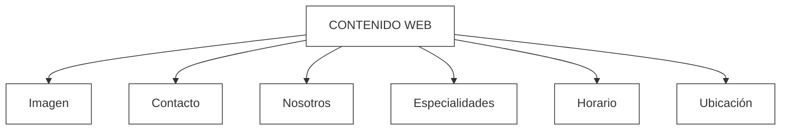

# Actividad 4: Diseñar Modelo Entidad-Relación

## Descripción

Se diseñó un modelo Entidad-Relación para representar la estructura de la base de datos que será utilizada por la página web del Consultorio Santa María Josefa. El modelo considera la información necesaria para administrar especialidades médicas, profesionales, horarios de atención, datos de contacto e información institucional.
 

