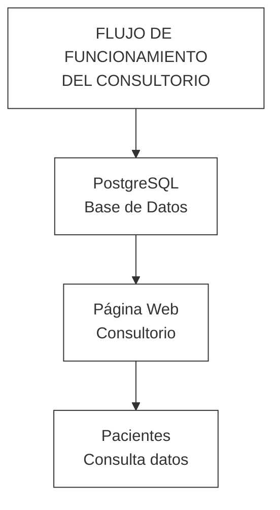

# Actividad 6: Conectar Base de Datos con Página Web

## Descripción

Se diseñó una propuesta de conexión entre la base de datos PostgreSQL y la página web del Consultorio Santa María Josefa[cite: 8]. El objetivo es que la información almacenada en la base de datos pueda ser mostrada de forma organizada a los pacientes a través del sitio web[cite: 8].

Mediante esta conexión, los datos relacionados con especialidades médicas, horarios de atención, ubicación y datos de contacto podrán mantenerse actualizados y disponibles para los usuarios[cite: 8].

## Diagrama de funcionamiento

## Flujo de información

| ELEMENTO | FUNCIÓN |
| :--- | :--- |
| PostgreSQL | Almacena la información del consultorio |
| Página Web | Muestra la información almacenada |
| Pacientes | Consultan Horarios, especialidades y datos de contacto |

## Resultado obtenido

Se definió un flujo de funcionamiento entre la base de datos PostgreSQL y la página web del Consultorio Santa María Josefa, permitiendo que la información almacenada pueda ser visualizada de manera organizada por los pacientes.
